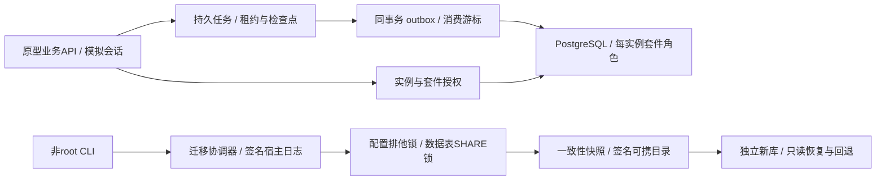
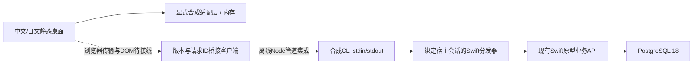

# MacNAS 原型架构（N-014）

Swift 6 / macOS 15部署目标，PostgreSQL 18。当前为非root CLI、无监听的业务API和两个自研可信样例；没有生产HTTP登录、系统Helper或正式接管。

- SafeFS拒绝路径越界、现存符号链接/硬链接和名称碰撞。完整目录描述符竞态防护尚未实现，不能作为不可信多用户文件服务的生产边界。
- StateStore支持内置版本化Schema1→2→3迁移，每个版本使用独立DDL事务。应用使用每实例独立角色，只能访问自己的Schema/表；核心、另一套件和其他实例的越权分别负测。
- 受控配置/数据库写入持有实例共享锁。导出获取排他锁，再以PostgreSQL SHARE锁等待旧写事务并冻结所有已知持久表，SELECT与pg_dump继续。取消只针对本次随机会话；配置被外部程序绕过API直接修改不在一致性保证内。
- MigrationCoordinator保存签名宿主日志、源指纹、已核对文件、候选库身份及阶段。识别导入/升级/发布先于日志推进的情况，复用经过证明的步骤；身份不明的空库保留后重新分配，非空或不同身份拒绝接管。
- 升级先保留签名源快照，在独立新库执行事务SQL，验证语义数据摘要后重新快照/签名。默认恢复为只读，回退保留源库、候选和快照；没有生产服务切换或跨Mac强fencing。
- PrototypePlatformAPI提供角色校验和实例绑定的套件票据。beginFixtureSession仅为模拟身份，不能作为生产认证。撤销/重新注册使旧epoch失效。
- 可信样例监督器执行时间/输出预算、取消和运行中撤权，环境中剔除数据库配置和测试签名私钥，使用独立临时HOME。它不是OS沙箱，尚无CPU/内存硬限额或第三方native准入。
- 私有Unix socket的trust认证用于合成测试，不能认证任意本机恶意进程。正式Keychain、主机认证、XPC调用方校验、签名安装和系统授权仍未实现。
- 进程锁不是分布式fencing；目录fsync为尽力执行。SIGKILL与当前Mac测试不能替代真实断电、macOS15运行、另一台Mac或物理磁盘验证。

细节见ADR-003与PROTOTYPE_API；结果见PROGRESS及N-009/N-010证据报告。

N-010以任务级数据库租约协调可信工作者，准备结果、数据库效果和通知在版本化表内持久化。事件序号分配串行到事务提交，确认收据去重；事件交付为至少一次。新表同时进入停写、快照及UTC语义摘要。细节见ADR-004；不承诺外部副作用exactly-once或大规模队列吞吐。

## N-011静态桌面

web/dist中的自研HTML/CSS/JavaScript不依赖框架或外部资产。桌面窗口、任务/通知/文件样例仅调用显式内存fixture；浏览器UI偏好独立保存，不是可携业务状态。生产业务数据库仍为PostgreSQL 18。

每次fixture调用检查会话/角色/资源范围，恢复模式拒绝所有写入及事件游标变化；UI身份切换清除窗口并丢弃旧响应。它不是生产安全边界。createBridgeAdapter只有通用request，缺失/拒绝不回退fixture，尚无浏览器实时传输或真实登录。合成35TB不是实盘测量，套件说明不等于OS沙箱。

用户已授权临时127.0.0.1:8766白名单静态预览；两次预览均停止。工具保存的站点拒绝及内置iab不可用导致浏览器验收待完成。模型/HTTP策略测试不替代实际视觉、键盘或响应式检查。详见ADR-005、DESKTOP_API和N-011证据。

## N-012 / N-013卷绑定与只读资料库

PrototypePlatformAPI新增FixtureStorageAPI与FixtureFileAPI，均无监听。FixtureVolumeRegistry仅接受合成观察清单，区分卷/介质/挂载会话；一次性预览绑定用户会话及修订，掉线/重挂载后不自动恢复权限。真实磁盘枚举和热拔插适配仍未实现。

DescriptorLibrary在显式内容批准时固定目录句柄，每次以openat逐级访问、拒绝链接/特殊文件/跨设备，核对目录身份及文件变化。只列出合成库的相对元数据，提供有界纯文本，不提供任何文件修改接口。库读者与撤销在业务层检查，读取结束再次核对会话/权限/清单。

这些宿主内存授权和句柄不进入可携包；现有逻辑引用仍保留，PostgreSQL业务存储不变。CLI storage demo只创建新的合成fixture目录。旧SafeFS与旧队列的合成卷输入接口保持其原有限制，不因本轮实现自动升级为生产路径或真实掉盘保护。N-011静态页仍未连接这些API。

细节见ADR-006、ADR-007和FIXTURE_STORAGE_API；父阶段与浏览器验收继续未完成。

## N-014消息桥接

DesktopBridge绑定已有Schema 3原型API和fixture会话，仅开放10个固定方法；请求不能选择身份、数据库、根路径或系统授权。close/退出撤销会话，业务层继续检查资源和只读状态。JSON解析独立限额、拒绝重复键/未知字段/非安全整数；响应投影业务展示数据并限制大小，错误只返回固定code。

CLI bridge fixture仅在调用方已有stdin/stdout上逐行交换JSON，没有监听或浏览器。Node测试从实际model.js客户端经管道调用独立Swift进程和私有PostgreSQL，验证持久性、幂等、事件确认、读者拒绝、只读恢复和分帧错误。Swift测试另外复用显式批准的合成资料库，检查文件消息的授权与撤销。

静态网页继续使用内存fixture；尚无生产认证、DOM桥接、完整业务DTO校验或大规模分页。新建CLI宿主不会自动批准卷/目录。无SQL Schema变化，无新依赖。详见ADR-008、DESKTOP_API和N-014验收报告。
