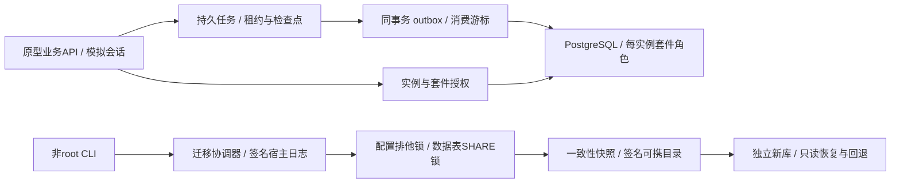
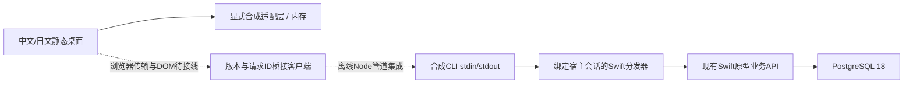

# MacNAS 原型架构（N-029 C3C2：宿主批准的容量账目列表）

C3C3B保持实际管理观察只读；C3C4A先定义独立执行呈现模型。C3C4A新增管理执行预览/明确一次确认的严格呈现模型：不同executionContextVersion和managed-execution purpose，固定来源/原始主体/模式、选中声明/摘要/意图及预览身份；0..16MiB、1..60000ms预览，时效从请求起点计算，小数单调时钟/倒退保护。确认仅显式confirmed:true，在派发前本地消费；之后任何错误保守uncertain且不能重试，关闭清空并隔离迟到。只读模式在时钟/服务前拒绝；旧nonce拒绝、最多16次预览和同步/异步回调隔离。 完整核心100份及全部实际内嵌/独立管道依赖逐字节复核与已发布C3C3B e99652b一致，明确复用其485Swift/16独立管道/全部CLI精确收据，本切片没有重新执行原生套件。只有dev_web语法/模型QA入口更新，由新前端覆盖。 本切片全部MOCK，没有该执行context的宿主批准/来源生成器/RPC/客户端适配器或DOM；filesystemVerified/executionAuthorized/capacityReleaseAuthorized恒false。本地一次消费不替代跨窗口/宿主持久幂等，不能以读取sourceID或观察分类授权执行；恢复目标批准单独处理，没有容量释放或永久清理。没有真实效果、浏览器点击、生产认证/fencing、macOS15运行或跨Mac证明。浏览器允许按需使用；继续自动中文提交/正常推送dev/bootstrap，旧迁移、父需求和原始资料保持。 N-030两个可移除下载器和离线安装已独立发布；包中心维持显式fixture，真实安装工具不启动应用。 见[ADR-033](docs/decisions/ADR-033-managed-execution-confirmation-model.md)及[C3C4A证据](docs/evidence/n029-c3c4a-2026-10-17.json)。

2026-10-17接续：N-030按用户新指令增加qBittorrent和Transmission两个默认内置、可卸载及离线重装的原生下载器。固定官方macOS归档/版本/SHA256、bundle身份/arm64和原签名；私有新目录默认安装两者，实际12步CLI验证分别卸载、移除选择跨进程保持、init拒绝重新插入和离线重装，5份合成配置/恢复/下载文件摘要不变。22项Python故障测试、383项Node、20语法、17静态策略和9需求负测通过；中日包中心明确为fixture；已实测隔离页面全部实际加载资产与本次主树逐字节一致，复用该12项浏览器功能记录，没有声称新的主树浏览器执行。未启动下载器/BT任务，未修改系统Applications、服务或网络。网页尚未接生产安装宿主。 旧核心94份及全部实际16内嵌/4独立依赖保持，复用已发布N-029 C3C2的471Swift/16独立管道和PG停止精确收据，本阶段没有新Swift全量。前端/预览/策略QA改动由新检查覆盖；原29规划/5来源/111父和97-13-1不变，913基线子项；SYS09仍很后期另1父7子。两轮DMG挂载/lipo参数失败及源码均保留，修复以真实包验证确认。当前Mac26.5.2私有工具结果不等于macOS15、跨Mac、生产认证或NAS发布。 见[N-030证据](docs/evidence/n030-2026-10-17.json)及[内置下载器契约](docs/contracts/BUILTIN_DOWNLOADERS.md)。

C3C2已接通独立宿主账目读取，C3C3A先提供严格管理观察呈现模型。C3C3A新增管理范围操作观察的严格只读呈现模型：固定scope/source/原始UTF8主体/模式及operation，可预先固定entry/allocation；可见必须是完整owned记录，entry released后owned继续收费。两种意图和revision独立，未知费用为null，身份与声明不可替换、终态不复活。显式单次读取、并发拒绝、有限错误码、关闭清空和迟到隔离。 完整核心94份及全部实际内嵌/独立管道依赖逐字节复核与已发布C3C2 126e3c9一致，复用其471Swift/16独立管道/全部CLI精确收据；本切片没有重跑原生套件。只有dev_web语法/模型测试入口改变，由新前端覆盖。 本切片为MOCK；当前宿主没有该管理观察外壳的批准/来源生成器/RPC/客户端适配器，网页不加载或提供模块。matchingReported只代表报告，filesystemVerified/executionAuthorized/capacityReleaseAuthorized均为false。整体费用取C3C2完整列表，不能相加多次操作观察。没有新的文件效果、DOM/浏览器、生产认证/fencing、macOS15运行或跨Mac证明。用户要求自动连续推进、中文阶段提交/正常推送dev/bootstrap，浏览器已获准按需使用；旧迁移及正式资料边界保持。 见[ADR-031](docs/decisions/ADR-031-managed-recycle-observation-model.md)及[C3C3A证据](docs/evidence/n029-c3c3a-2026-10-17.json)。

C3A实现0005/Schema5及持久容量元数据：单条16MiB、共用64MiB、64历史和8个未终结预留；原始主体/数据库/宿主/实例/代次/资料库绑定，独立CAS，和文件日志共用事务准入锁。owned不释放，armed保留全部费用并阻止新准入；纯MetadataOnly方法遇已知物理标记即拒绝。旧0001–0004及Migration4原字节不变。 新表进入14表停写、完整UTC摘要和严格权限/结构核对；1–4投影保留。本阶段只验证数据库账目，未接入物理库存、原生上传复制/回收恢复或新执行RPC/UI；现有网页仍为Schema3内存fixture。旧回收/恢复各3次SIGKILL在新全量中重跑，不是容量执行者的中断证明。下一步C3B接单物理合成树与封闭现场凭据，随后才是执行/列表/界面。用户要求自动连续开发并暂停浏览器/预览；仅限新建TestLab合成实例。 详见[ADR-027](docs/decisions/ADR-027-schema5-durable-capacity-ledger.md)及[C3A证据](docs/evidence/n029-c3a-2026-10-17.json)。

Swift 6 / macOS 15部署目标，PostgreSQL 18。当前为非root CLI、无监听的业务API和两个自研可信样例；没有生产HTTP登录、系统Helper或正式接管。

N-029 A新增0004、recycle_entries与file_effect_operations，以及宿主内部数据库日志。支持Schema1→2→3→4，原0001–0003不变；精确校验表/约束/函数/权限，12表统一停写，完整UTC摘要保留旧Schema投影。原始UTF8主体、幂等/CAS和容量准入在SQL事务内处理；A没有vault注册、文件移动、回收RPC或网页入口。A完整自动回归已通过，结果以[A证据](docs/evidence/n029-a-2026-10-16.json)为准；[B第一段的独立宿主批准、私有回收区和单向效果](docs/plans/N-029-B-ACCEPTANCE.md)已通过355项Swift及新前端完整自动验证，见[B证据](docs/evidence/n029-b-2026-10-16.json)；B2恢复执行者亦已通过新未过滤374项及新前端，见[B2证据](docs/evidence/n029-b2-2026-10-16.json)；独立目标批准、原entry结算见[ADR-024](docs/decisions/ADR-024-synthetic-restore-executor.md)，C再接桥接/共享fixture/界面。设计边界见[ADR-021](docs/decisions/ADR-021-recoverable-recycle-journal.md)、[ADR-022](docs/decisions/ADR-022-schema4-file-effect-foundation.md)、[ADR-023](docs/decisions/ADR-023-synthetic-recycle-executor.md)和[N-029分步实现](docs/plans/N-029-RECYCLE-JOURNAL-IMPLEMENTATION.md)。

普通Schema4可携流程拒绝任何新日志历史及未知/payload宿主布局，空日志恢复仍默认只读；诊断数据库快照只保存元数据。摘要和新日志准入有4,000,000字节预算，旧任务/事件仍可后续增长，尚无整库容量fencing。B第一段已在新建合成实例验证批准、vault跨进程锁、预留后置记录和prepared取消证明；后置CAS不受旧元数据后续增长的全局聚合预算阻断，但数据库错误仍可能保留不确定效果。数据库行、SQL完成夹具及N-028有限模型均不能证明文件已移动或真实SIGKILL恢复。

N-027增加单常规文件复制：独立目标复制批准、固定两端、32KiB宿主分块、私有暂存/SHA256/RENAME_EXCL、短期结果及原目标重读，来源始终保留。16MiB单文件，同设备合成目录；跨设备、目录、批量、移动和持久恢复未实现。共享发布原语在rename后记录完整标记，检查发布后同长度改写并恢复mtime的情况，异常为uncertain并保留目标；不声称敌对本机进程强fencing。详见[ADR-020](docs/decisions/ADR-020-bounded-file-copy.md)。

网页合成树的初始UTF8、已发布二进制及全部上传/复制预留共享64MiB上限，发布原子转换计量，取消/失败/到期仅释放未发布预留，已发布字节继续计量；会话结束或目录source.dispose清树。客户端窗口和来源中断需回收迟到预览头，不以关闭共享连接或重连扩预算代替清理。复制目标选择器按现有目录来源每页50项读取；实际浏览器仍与模型/元素替身/真实管道分开验收。静态fixture继续Schema3，具名宿主客户端接受3/4并固定连接内版本，网页仍不连接Swift/NAS。

N-024补齐建文件夹和同目录重命名：独立宿主写批准、绑定目录与源身份的预览、不覆盖执行、同宿主结果查询及成功后重读。短操作同步完成，32条/300秒内存回执不作为持久任务或数据库替代；Schema 3不变。网页只修改显式合成树，原生测试另在新建批准目录验证真实文件系统，二者不等同于浏览器已连接NAS。见[ADR-018](docs/decisions/ADR-018-guarded-fixture-file-operations.md)。

N-025/N-026增加有界上传/下载及文件中心确认、进度、取消、校验后保存与目标重读。独立宿主上传批准、私有暂存、固定来源文件描述符、32KiB背压块和双重摘要约束外部文件效果；16MiB文件/64MiB上传预留/8活动能力和32条短期结果明确限制资源。原生文件与内存树分开验证，浏览器仍不连接NAS。没有持久文件任务、重启恢复、GB级或生产通道，Schema3不变，详见[ADR-019](docs/decisions/ADR-019-bounded-fixture-file-transfers.md)。

N-022补充可信合成管道的事件来源上下文、第14个观察消息与显式旧批核对模型；宿主固定来源，事件写入使用捕获的StateStore，防止重绑把写入投向新库。上下文仅是防错等值标记，不构成生产认证/强fencing；核对不清旧批、不采用候选连接。见[ADR-016](docs/decisions/ADR-016-fixture-event-source-context.md)。

N-023在既有目录来源之上增加file-browser.js：默认50项、累加最多1000项、64条历史，导航成功后更新位置，当前目录内搜索/排序/多选与只读预览有界。网页窗口接入侧栏、历史/路径、列表/图标和详情，但仍仅使用合成fixture，实际DOM/键盘/布局未验证。基础directory-view当前页协议不变，原生核心/SQL也未因N-023改变。见[ADR-017](docs/decisions/ADR-017-continuous-file-browser.md)。

产品接续以用户流程为单位补齐文件管理与控制面板；当前业务缺口、macOS适配和网络配置/回滚要求见[DSM整体对照](docs/plans/DSM-FUNCTIONAL-BASELINE.md)与[控制面板及网络详细对照](docs/plans/DSM-CONTROL-PANEL-NETWORK-REFERENCE.md)。这些设计不等于已有生产服务，既有111父项和优先级保持。

- SafeFS拒绝路径越界、现存符号链接/硬链接和名称碰撞。完整目录描述符竞态防护尚未实现，不能作为不可信多用户文件服务的生产边界。
- StateStore支持内置版本化Schema1→2→3→4迁移，每个版本使用独立DDL事务。应用使用每实例独立角色，只能访问自己的Schema/表；核心、另一套件和其他实例的越权分别负测。Schema4验证两套件对新核心表的全部8项权限、核心Schema权限和验证函数EXECUTE；隔离导入仅在bootstrap阶段收紧pg_restore重建的PUBLIC函数默认权限，普通验证不自动修复权限。
- 受控配置/数据库写入持有实例共享锁。导出获取排他锁，再以PostgreSQL SHARE锁等待旧写事务并冻结所有已知持久表，SELECT与pg_dump继续。取消只针对本次随机会话；配置被外部程序绕过API直接修改不在一致性保证内。
- MigrationCoordinator保存签名宿主日志、源指纹、已核对文件、候选库身份及阶段。识别导入/升级/发布先于日志推进的情况，复用经过证明的步骤；身份不明的空库保留后重新分配，非空或不同身份拒绝接管。
- 升级先保留签名源快照，在独立新库执行事务SQL，验证语义数据摘要后重新快照/签名。默认恢复为只读，回退保留源库、候选和快照；没有生产服务切换或跨Mac强fencing。
- PrototypePlatformAPI提供角色校验和实例绑定的套件票据。beginFixtureSession仅为模拟身份，不能作为生产认证。撤销/重新注册使旧epoch失效。
- 可信样例监督器执行时间/输出预算、取消和运行中撤权，环境中剔除数据库配置和测试签名私钥，使用独立临时HOME。它不是OS沙箱，尚无CPU/内存硬限额或第三方native准入。
- 私有Unix socket的trust认证用于合成测试，不能认证任意本机恶意进程。正式Keychain、主机认证、XPC调用方校验、签名安装和系统授权仍未实现。
- 进程锁不是分布式fencing。旧可携目录同步仍为尽力执行；B文件执行器的双父fsync失败会拒绝完成并保留不确定结果。SIGKILL与当前Mac测试不能替代真实断电、macOS15运行、另一台Mac或物理磁盘验证。

细节见ADR-003与PROTOTYPE_API；结果见PROGRESS及N-009/N-010证据报告。

N-010以任务级数据库租约协调可信工作者，准备结果、数据库效果和通知在版本化表内持久化。事件序号分配串行到事务提交，确认收据去重；事件交付为至少一次。新表同时进入停写、快照及UTC语义摘要。细节见ADR-004；不承诺外部副作用exactly-once或大规模队列吞吐。

## N-011静态桌面

web/dist中的自研HTML/CSS/JavaScript不依赖框架或外部资产。桌面窗口、任务/通知/文件样例仅调用显式内存fixture；浏览器UI偏好独立保存，不是可携业务状态。生产业务数据库仍为PostgreSQL 18。

每次fixture调用检查会话/角色/资源范围，恢复模式拒绝所有写入及事件游标变化；UI身份切换清除窗口并丢弃旧响应。它不是生产安全边界。createBridgeAdapter只有通用request，缺失/拒绝不回退fixture，尚无浏览器实时传输或真实登录。合成35TB不是实盘测量，套件说明不等于OS沙箱。

用户已授权临时127.0.0.1:8766白名单静态预览；N-011两次预览均停止。N-021期间用户已回到Mac mini并恢复排查，新的临时预览可手动显示，内置iab可列出页面但观察内容仍被保存的站点权限拒绝。用户截图已确认正确的8766“浏览：始终允许”，但工具仍拒绝，原因未知；不再要求修改正确条目，不换通道绕过。模型/HTTP策略测试不替代实际视觉、键盘或响应式检查，本轮临时预览已关闭。详见ADR-005、DESKTOP_API和浏览器验收清单。

## N-012 / N-013卷绑定与只读资料库

PrototypePlatformAPI新增FixtureStorageAPI与FixtureFileAPI，均无监听。FixtureVolumeRegistry仅接受合成观察清单，区分卷/介质/挂载会话；一次性预览绑定用户会话及修订，掉线/重挂载后不自动恢复权限。真实磁盘枚举和热拔插适配仍未实现。

DescriptorLibrary在显式内容批准时固定目录句柄，每次以openat逐级访问、拒绝链接/特殊文件/跨设备，核对目录身份及文件变化。只列出合成库的相对元数据，提供有界纯文本，不提供任何文件修改接口。库读者与撤销在业务层检查，读取结束再次核对会话/权限/清单。

这些宿主内存授权和句柄不进入可携包；现有逻辑引用仍保留，PostgreSQL业务存储不变。CLI storage demo只创建新的合成fixture目录。旧SafeFS与旧队列的合成卷输入接口保持其原有限制，不因本轮实现自动升级为生产路径或真实掉盘保护。N-011静态页仍未连接这些API。

细节见ADR-006、ADR-007和FIXTURE_STORAGE_API；父阶段与浏览器验收继续未完成。

## N-014消息桥接

DesktopBridge绑定已有Schema 3原型API和fixture会话，仅开放10个固定方法；请求不能选择身份、数据库、根路径或系统授权。close/退出撤销会话，业务层继续检查资源和只读状态。JSON解析独立限额、拒绝重复键/未知字段/非安全整数；响应投影业务展示数据并限制大小，错误只返回固定code。

CLI bridge fixture仅在调用方已有stdin/stdout上逐行交换JSON，没有监听或浏览器。Node测试从实际model.js客户端经管道调用独立Swift进程和私有PostgreSQL，验证持久性、幂等、事件确认、读者拒绝、只读恢复和分帧错误。Swift测试另外复用显式批准的合成资料库，检查文件消息的授权与撤销。

静态网页继续使用内存fixture；尚无生产认证、DOM桥接或大规模分页。新建CLI宿主不会自动批准卷/目录。完整客户端DTO校验由下节N-015补充。无SQL Schema变化，无新依赖。详见ADR-008、DESKTOP_API和N-014验收报告。

## N-015具名业务客户端

bridge-client.js包装通用消息适配器，校验overview/任务/事件/资料库/目录项/文本，并固定宿主用户、角色及模式。返回展示数据递归冻结，固定翻译键与普通标题/文件名/文本区分，不补造时间或实盘容量。

独立随机请求前缀避免同宿主重建客户端重放。默认15秒、32个并发；关闭/取消/超时使连接失效，剩余等待取消，迟到响应不进入调用方。传输收到AbortSignal和可选closeTransport钩子；它不能强制外部传输停止或回滚已提交任务。显式标签意图保留业务键/值用于重试，实际管道测试验证提交后丢失响应仍返回原任务。

每客户端最多32个消费者、每消费者100条未确认事件，串行轮询/确认并核对重放及已交付位置。宿主继续承担认证/授权和数据库游标边界。新的JavaScript不加入HTML或静态路由；静态网页与W01–W10窗口专项仍未验收，用户回家后按浏览器清单执行。详见ADR-009和N-015验收报告。

## N-016任务读取边界

任务统计在PostgreSQL按受众聚合；新增listJobsPage使用唯一ID的C/UTF-8字节顺序，每页默认50、最多100。60秒单调寿命、会话/实例/数据库/用户/角色/模式/页大小绑定的内存一次性游标，每API最多128个待用令牌和128个消费墓碑；失败的SQL/校验/编码不消费。列表为实时页，不能当作快照；旧数组超过4096条明确拒绝，仍有字节预算。Schema 3和可携数据不变。见[ADR-010](docs/decisions/ADR-010-bounded-job-pages.md)及[接口契约](docs/contracts/DESKTOP_API.md)。网页仍使用内存演示，W01–W10等用户回家实测。

## N-017当前页任务展示

task-pages.js把显式fixture来源/具名客户端来源投影为有界任务视图。控制器只保留当前页，串行读取/取消，关闭清空并丢弃迟到结果；窗口dispose不关闭共享连接，身份切换关闭旧来源。任务名区分普通文本和固定翻译键，不传递原始任务载荷或伪造时间。

静态任务窗口每页3项，首页另有2项编号顺序预览，统计独立读取；搜索/过滤明确限当前页，下一页替换而不累积，错误等待显式重读。HTML只新增task-pages脚本，主机客户端仍未加载，没有浏览器传输或数据库回退。本地discardJobPage不撤销宿主预算；宿主令牌仍依照60秒期限清理。

模型/Node与真实管道验证不能证明DOM、焦点、布局或翻译质量。W01–W10及T01–T08全待实测，父阶段P03未验收；见[ADR-011](docs/decisions/ADR-011-task-page-presentation.md)和[验收范围](docs/plans/N-017-ACCEPTANCE.md)。

## N-018待确认通知视图

notification-view.js显式借用fixture会话或具名客户端，保持固定容量（默认100）、不可变事件投影与同提供者/消费者操作串行。未确认满额停止读取，成功ACK后清理展示；失败锁定原批/原交付目标，显式重试不能带上后续事件。未知任务用普通文案，不反向读取所有任务；数量只表示本地已加载待确认内容。

dispose不关闭共享连接，不回滚数据库操作，迟到成功/失败不能恢复旧视图。恢复模式在调用前拒绝轮询/确认；断连保留未解决批次，不自动重连，当前协议缺少持久消费状态查询/安全重连核对。真实持久性继续由PostgreSQL 18原有事务和收据保证，无Schema变化。

HTML仅增加通知视图脚本，具名客户端不加载/静态提供，connect-src仍为none。网页仍为内存演示，Node/真实管道不证明DOM或浏览器业务连接。W01–W10、T01–T08、N01–N06全部等待用户回家；见[ADR-012](docs/decisions/ADR-012-bounded-notification-view.md)及[验收范围](docs/plans/N-018-ACCEPTANCE.md)。

## N-019有界目录查询

DescriptorLibrary新增UTF-8名称顺序的受限目录页；每次扫描最多8192项、名称共1MiB、单调5秒，只保留最多101份候选元数据及有界名称碰撞摘要。超过预算完整拒绝，旧1000项数组语义不变。这是逐页重扫原型，尚无生产大目录索引或吞吐证明，5秒检查也不能强制中断任意文件系统I/O。

目录标记在扫描前后、继续页及编码后核对，变化要求从头读取；普通文件原地变化可能不改变父目录标记，元数据仍是live，不是文件系统快照。随机一次性目录能力绑定现有会话/实例/数据库/受众以及库/路径/卷批准/修订/内容reader，每API64待用/64墓碑，整链60秒。成功编码和复查后才消费，目录授权仍需显式批准，恢复不能扩大授权。

第12个固定方法listFilesPage与具名客户端支持精确页DTO、跨页UTF-8顺序及有界本地继续链；普通名称不进入词典，客户端本地discardFilePage无RPC，不释放宿主预算。Schema 3/SQL表与生产身份保持原范围。实际Node子进程管道仅由测试宿主先批准新建合成目录，生产消息/CLI没有新增自动授权入口。

静态网页尚未接入目录页，HTML/CSP/白名单不变，W/T/N及完整浏览器清单仍全部待测。取舍与验证范围见[ADR-013](docs/decisions/ADR-013-bounded-directory-pages.md)及[N-019验收范围](docs/plans/N-019-ACCEPTANCE.md)。

## N-020目录当前页展示

directory-view.js显式借用桌面已有fixture会话或具名客户端，投影普通名称/路径/文本及有界元数据；来源dispose与窗口dispose都不关闭共享提供者，由身份所有者统一关闭一次。控制器只保留当前页，库/路径/窗口/身份代次丢弃迟到页及预览，失败保留标注的旧结果并等待显式重读。

静态文件窗口每页3项，搜索/类型过滤仅查本页，摘要独立，继续替换/重读回头；固定合成树有空/嵌套目录和私有库，时间及估计未知。fixture标记synthetic-fixed-directory，不冒充真实扫描/批准；真实宿主仍按N-019目录标记和预算读取。纯文本预览最多64KiB并再次校验上下文及字节数，没有文件写入接口。

HTML/白名单仅增加directory-view.js，具名客户端仍未加载/提供，CSP connect-src为none。实际Node/Swift管道经展示来源/控制器，现有40份核心不变，204项原生证据与重跑的1项内嵌Node场景明确组成205项覆盖，不称本轮新全量。详见[ADR-014](docs/decisions/ADR-014-directory-page-presentation.md)及[证据](docs/evidence/n020-2026-10-15.json)。W/T/N及新增F01–F08全部等用户回家，DOM、布局、焦点、键盘和翻译质量仍未验收。

## N-021通知消费位置观察

DurableJobQueue在只读事务中按consumerID与受众读取现有event_consumers主键行；不创建行、不推进ack/delivered、不删除事件/收据。无当前受众行与他人行统一投影为notVisible及null，自己的空行返回visible/0/0。Schema 3及所有迁移不变。

API查询前、查询后及最终编码后核对已有会话、用户原始字节、角色、允许模式、实例身份/generation与数据库。完整实例验证仍在构造阶段，查询仍验证队列Schema，前后检查只读相关元数据。恢复/回退模式可查询，写游标继续拒绝；最终检查后仍可能发生并发变化，此机制不提供生产认证或强fencing。

第13个固定方法eventConsumerStatus只接收consumerID，返回精确五字段/version 1 DTO；位置必须为JS安全非负整数，ack不大于delivered，不可见时两位置显式null。具名客户端与同消费者poll/ACK串行，采用原有并发/超时/取消上限，不为只读查询保留无限消费者状态。结果仅观察，不回填本地ack/seen，不授予ACK、不清旧通知批或创建新连接。

实际Swift/PostgreSQL及Node独立进程管道核对ACK已提交而响应扣留/超时后的位置；旧视图仍保持未解决批次。来源证明及显式批次协调留待N-022，不能把空轮询当确认。HTML/CSS/desktop.js及静态路由不变，网页仍只连fixture。见[ADR-015](docs/decisions/ADR-015-read-only-event-consumer-status.md)及[N-021验收](docs/plans/N-021-ACCEPTANCE.md)；新的未过滤完整回归必须覆盖全部原生核心和嵌入Node依赖。

## C1只读核对模型

recycle-observation.js仅验证C1精确正文/日志记录并保持读取视图；观察分类与日志完成分开展示，未知结果不推断费用释放，旧entry历史与当前计量分别处理。模型固定operation/主体和可选entry，首个可见响应后拒绝意图/版本倒退；关闭只清本地观察，迟到结果不复活、不关闭借用来源。它不认证来源或签发批准，C2需当前会话/实例/DB固定的宿主投影和具名适配器。代码未被静态桌面加载，见正文契约与ADR-025。

## C2只读操作核对桥接

C2接通宿主独立批准的只读操作核对：唯一消息observeRecycleOperation仅接受标准operationID，不签发批准或执行效果。许可固定原始管理员主体、当前会话、API创建时实例/代次/DB/宿主及登记，读取块和响应编码后均复核；结束/撤销只移除内存批准，不改日志或载荷。 C1正文保持精确五字段/十字段日志记录，桥接另包版本化来源context。每API私有nonce与长度分帧会话/锚点/登记做HMAC，客户端固定首个有效标记，另API/会话/登记不能混入旧视图。标记只是防错等值，不是认证或强fencing；重新启动须新批准和新客户端。借用模型适配器固定客户端，dispose忽略迟到结果且不关闭共享连接；显式abort/超时沿用已有关闭政策，不自动重连。

新未过滤20261016T224020-ea5f0bb6通过391项Swift（5589.763秒，新增17，含5项内嵌Node→Swift场景）、16项独立CLI管道（359.963秒）及全部演练，私有PG正常关闭。新前端20261017T002359-a2cfd8f7通过306 Node/17语法/15静态策略/9需求负测，无监听。74份完整核心、99份原生输入、联合126份当前源码及需求冻结匹配；隔离工作树使用Build/swift-n029-c2，没有并行干扰B2测试库。 收尾核对时间2026-10-17T00:24:01.524543+09:00。 仅TestLab新建合成实例及当前Apple Silicon Mac，不接执行/列表/共享容量/网页DOM或生产NAS。回收计量尚未加入网页64MiB可见与传输预留；普通portable仍拒绝登记vault/日志。没有永久删除/到期清扫、真实断电、macOS15运行、跨Mac、物理池或生产认证证据；旧45 PASS/7 PARTIAL浏览器记录不用于本阶段，本轮按用户指令未使用浏览器或预览。 详情见ADR-026和C2阶段证据。
