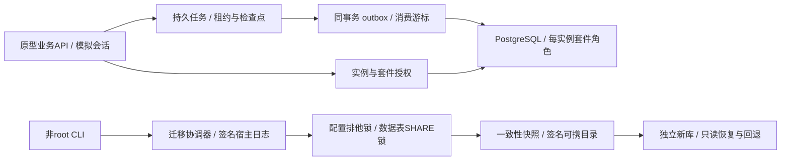
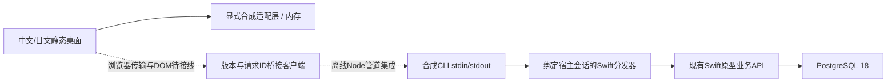

# MacNAS 原型架构（N-019）

Swift 6 / macOS 15部署目标，PostgreSQL 18。当前为非root CLI、无监听的业务API和两个自研可信样例；没有生产HTTP登录、系统Helper或正式接管。

- SafeFS拒绝路径越界、现存符号链接/硬链接和名称碰撞。完整目录描述符竞态防护尚未实现，不能作为不可信多用户文件服务的生产边界。
- StateStore支持内置版本化Schema1→2→3迁移，每个版本使用独立DDL事务。应用使用每实例独立角色，只能访问自己的Schema/表；核心、另一套件和其他实例的越权分别负测。
- 受控配置/数据库写入持有实例共享锁。导出获取排他锁，再以PostgreSQL SHARE锁等待旧写事务并冻结所有已知持久表，SELECT与pg_dump继续。取消只针对本次随机会话；配置被外部程序绕过API直接修改不在一致性保证内。
- MigrationCoordinator保存签名宿主日志、源指纹、已核对文件、候选库身份及阶段。识别导入/升级/发布先于日志推进的情况，复用经过证明的步骤；身份不明的空库保留后重新分配，非空或不同身份拒绝接管。
- 升级先保留签名源快照，在独立新库执行事务SQL，验证语义数据摘要后重新快照/签名。默认恢复为只读，回退保留源库、候选和快照；没有生产服务切换或跨Mac强fencing。
- PrototypePlatformAPI提供角色校验和实例绑定的套件票据。beginFixtureSession仅为模拟身份，不能作为生产认证。撤销/重新注册使旧epoch失效。
- 可信样例监督器执行时间/输出预算、取消和运行中撤权，环境中剔除数据库配置和测试签名私钥，使用独立临时HOME。它不是OS沙箱，尚无CPU/内存硬限额或第三方native准入。
- 私有Unix socket的trust认证用于合成测试，不能认证任意本机恶意进程。正式Keychain、主机认证、XPC调用方校验、签名安装和系统授权仍未实现。
- 进程锁不是分布式fencing；目录fsync为尽力执行。SIGKILL与当前Mac测试不能替代真实断电、macOS15运行、另一台Mac或物理磁盘验证。

细节见ADR-003与PROTOTYPE_API；结果见PROGRESS及N-009/N-010证据报告。

N-010以任务级数据库租约协调可信工作者，准备结果、数据库效果和通知在版本化表内持久化。事件序号分配串行到事务提交，确认收据去重；事件交付为至少一次。新表同时进入停写、快照及UTC语义摘要。细节见ADR-004；不承诺外部副作用exactly-once或大规模队列吞吐。

## N-011静态桌面

web/dist中的自研HTML/CSS/JavaScript不依赖框架或外部资产。桌面窗口、任务/通知/文件样例仅调用显式内存fixture；浏览器UI偏好独立保存，不是可携业务状态。生产业务数据库仍为PostgreSQL 18。

每次fixture调用检查会话/角色/资源范围，恢复模式拒绝所有写入及事件游标变化；UI身份切换清除窗口并丢弃旧响应。它不是生产安全边界。createBridgeAdapter只有通用request，缺失/拒绝不回退fixture，尚无浏览器实时传输或真实登录。合成35TB不是实盘测量，套件说明不等于OS沙箱。

用户已授权临时127.0.0.1:8766白名单静态预览；两次预览均停止。工具保存的站点拒绝及内置iab不可用导致浏览器验收待完成。模型/HTTP策略测试不替代实际视觉、键盘或响应式检查。详见ADR-005、DESKTOP_API和N-011证据。

## N-012 / N-013卷绑定与只读资料库

PrototypePlatformAPI新增FixtureStorageAPI与FixtureFileAPI，均无监听。FixtureVolumeRegistry仅接受合成观察清单，区分卷/介质/挂载会话；一次性预览绑定用户会话及修订，掉线/重挂载后不自动恢复权限。真实磁盘枚举和热拔插适配仍未实现。

DescriptorLibrary在显式内容批准时固定目录句柄，每次以openat逐级访问、拒绝链接/特殊文件/跨设备，核对目录身份及文件变化。只列出合成库的相对元数据，提供有界纯文本，不提供任何文件修改接口。库读者与撤销在业务层检查，读取结束再次核对会话/权限/清单。

这些宿主内存授权和句柄不进入可携包；现有逻辑引用仍保留，PostgreSQL业务存储不变。CLI storage demo只创建新的合成fixture目录。旧SafeFS与旧队列的合成卷输入接口保持其原有限制，不因本轮实现自动升级为生产路径或真实掉盘保护。N-011静态页仍未连接这些API。

细节见ADR-006、ADR-007和FIXTURE_STORAGE_API；父阶段与浏览器验收继续未完成。

## N-014消息桥接

DesktopBridge绑定已有Schema 3原型API和fixture会话，仅开放10个固定方法；请求不能选择身份、数据库、根路径或系统授权。close/退出撤销会话，业务层继续检查资源和只读状态。JSON解析独立限额、拒绝重复键/未知字段/非安全整数；响应投影业务展示数据并限制大小，错误只返回固定code。

CLI bridge fixture仅在调用方已有stdin/stdout上逐行交换JSON，没有监听或浏览器。Node测试从实际model.js客户端经管道调用独立Swift进程和私有PostgreSQL，验证持久性、幂等、事件确认、读者拒绝、只读恢复和分帧错误。Swift测试另外复用显式批准的合成资料库，检查文件消息的授权与撤销。

静态网页继续使用内存fixture；尚无生产认证、DOM桥接或大规模分页。新建CLI宿主不会自动批准卷/目录。完整客户端DTO校验由下节N-015补充。无SQL Schema变化，无新依赖。详见ADR-008、DESKTOP_API和N-014验收报告。

## N-015具名业务客户端

bridge-client.js包装通用消息适配器，校验overview/任务/事件/资料库/目录项/文本，并固定宿主用户、角色及模式。返回展示数据递归冻结，固定翻译键与普通标题/文件名/文本区分，不补造时间或实盘容量。

独立随机请求前缀避免同宿主重建客户端重放。默认15秒、32个并发；关闭/取消/超时使连接失效，剩余等待取消，迟到响应不进入调用方。传输收到AbortSignal和可选closeTransport钩子；它不能强制外部传输停止或回滚已提交任务。显式标签意图保留业务键/值用于重试，实际管道测试验证提交后丢失响应仍返回原任务。

每客户端最多32个消费者、每消费者100条未确认事件，串行轮询/确认并核对重放及已交付位置。宿主继续承担认证/授权和数据库游标边界。新的JavaScript不加入HTML或静态路由；静态网页与W01–W10窗口专项仍未验收，用户回家后按浏览器清单执行。详见ADR-009和N-015验收报告。

## N-016任务读取边界

任务统计在PostgreSQL按受众聚合；新增listJobsPage使用唯一ID的C/UTF-8字节顺序，每页默认50、最多100。60秒单调寿命、会话/实例/数据库/用户/角色/模式/页大小绑定的内存一次性游标，每API最多128个待用令牌和128个消费墓碑；失败的SQL/校验/编码不消费。列表为实时页，不能当作快照；旧数组超过4096条明确拒绝，仍有字节预算。Schema 3和可携数据不变。见[ADR-010](docs/decisions/ADR-010-bounded-job-pages.md)及[接口契约](docs/contracts/DESKTOP_API.md)。网页仍使用内存演示，W01–W10等用户回家实测。

## N-017当前页任务展示

task-pages.js把显式fixture来源/具名客户端来源投影为有界任务视图。控制器只保留当前页，串行读取/取消，关闭清空并丢弃迟到结果；窗口dispose不关闭共享连接，身份切换关闭旧来源。任务名区分普通文本和固定翻译键，不传递原始任务载荷或伪造时间。

静态任务窗口每页3项，首页另有2项编号顺序预览，统计独立读取；搜索/过滤明确限当前页，下一页替换而不累积，错误等待显式重读。HTML只新增task-pages脚本，主机客户端仍未加载，没有浏览器传输或数据库回退。本地discardJobPage不撤销宿主预算；宿主令牌仍依照60秒期限清理。

模型/Node与真实管道验证不能证明DOM、焦点、布局或翻译质量。W01–W10及T01–T08全待实测，父阶段P03未验收；见[ADR-011](docs/decisions/ADR-011-task-page-presentation.md)和[验收范围](docs/plans/N-017-ACCEPTANCE.md)。

## N-018待确认通知视图

notification-view.js显式借用fixture会话或具名客户端，保持固定容量（默认100）、不可变事件投影与同提供者/消费者操作串行。未确认满额停止读取，成功ACK后清理展示；失败锁定原批/原交付目标，显式重试不能带上后续事件。未知任务用普通文案，不反向读取所有任务；数量只表示本地已加载待确认内容。

dispose不关闭共享连接，不回滚数据库操作，迟到成功/失败不能恢复旧视图。恢复模式在调用前拒绝轮询/确认；断连保留未解决批次，不自动重连，当前协议缺少持久消费状态查询/安全重连核对。真实持久性继续由PostgreSQL 18原有事务和收据保证，无Schema变化。

HTML仅增加通知视图脚本，具名客户端不加载/静态提供，connect-src仍为none。网页仍为内存演示，Node/真实管道不证明DOM或浏览器业务连接。W01–W10、T01–T08、N01–N06全部等待用户回家；见[ADR-012](docs/decisions/ADR-012-bounded-notification-view.md)及[验收范围](docs/plans/N-018-ACCEPTANCE.md)。

## N-019有界目录查询

DescriptorLibrary新增UTF-8名称顺序的受限目录页；每次扫描最多8192项、名称共1MiB、单调5秒，只保留最多101份候选元数据及有界名称碰撞摘要。超过预算完整拒绝，旧1000项数组语义不变。这是逐页重扫原型，尚无生产大目录索引或吞吐证明，5秒检查也不能强制中断任意文件系统I/O。

目录标记在扫描前后、继续页及编码后核对，变化要求从头读取；普通文件原地变化可能不改变父目录标记，元数据仍是live，不是文件系统快照。随机一次性目录能力绑定现有会话/实例/数据库/受众以及库/路径/卷批准/修订/内容reader，每API64待用/64墓碑，整链60秒。成功编码和复查后才消费，目录授权仍需显式批准，恢复不能扩大授权。

第12个固定方法listFilesPage与具名客户端支持精确页DTO、跨页UTF-8顺序及有界本地继续链；普通名称不进入词典，客户端本地discardFilePage无RPC，不释放宿主预算。Schema 3/SQL表与生产身份保持原范围。实际Node子进程管道仅由测试宿主先批准新建合成目录，生产消息/CLI没有新增自动授权入口。

静态网页尚未接入目录页，HTML/CSP/白名单不变，W/T/N及完整浏览器清单仍全部待测。取舍与验证范围见[ADR-013](docs/decisions/ADR-013-bounded-directory-pages.md)及[N-019验收范围](docs/plans/N-019-ACCEPTANCE.md)。
