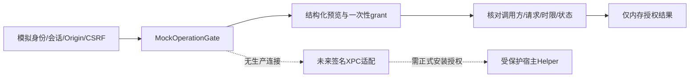

# N-003 最小特权与系统操作协议

`OperationRequest={operation,scope,preview,expectedState,requestID}`；commit另带一次性token。token绑定请求全文、用户和session，30秒有效；失败消费、拒绝重放、状态变化重新预览。只接受fixture逻辑scope和simulateShareChange。

已编码的负测：未验证调用方、非管理员、跨用户、跨Origin、缺CSRF、错session、路径scope、真实系统动作、过期、预览变化、状态变化、重放/未知token。全部使用合成身份。

`verifiedMockCaller` 只由测试输入，不能作为生产信任证明。未来XPC必须验证真实审计令牌和签名需求，Web必须实现真正的会话/CSRF/MFA/授权。当前没有Web认证系统或root服务；没有shell命令执行接口。

真实动作未来必须dry-run→明确所有者批准→受保护安装的Helper执行白名单结构动作→审计/可恢复回退；便携外置目录的代码不得以root启动。没有批准时拒绝正式共享/系统账户/ACL/阵列/服务变更。

## N-029 C2的合成文件观察边界

独立宿主observe批准不进入RPC，也不授予回收/恢复/结算。它只在TestLab硬门下按当前原始管理员主体/会话、固定API锚点及登记校验后读取，许可在读取块和编码后复查。新来源HMAC仅防止不同API/会话/登记的结果误混，不是生产认证、签名执行许可或跨进程强fencing。结束/撤销只移除内存批准，不清扫载荷/日志；notVisible、超时或窗口关闭都不能证明无文件效果或可释放费用。正式NAS、永久清理、系统账户/ACL/helper/共享/服务/网络/public等权限仍未开放，静态网页仍无生产传输，详见ADR-026和C2证据。
