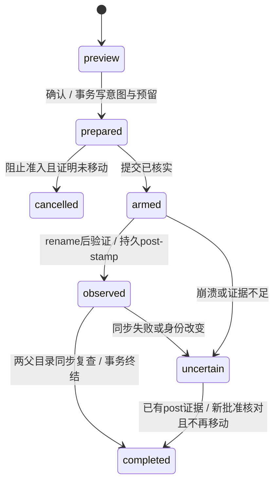

# N-028：可恢复回收站设计

日期：2026-10-16。状态：设计与抽象故障模型验证，**功能尚未实现，当前仍为Schema 3**。[ADR-021](../decisions/ADR-021-recoverable-recycle-journal.md)确定实现约束，[N-029](N-029-RECYCLE-JOURNAL-IMPLEMENTATION.md)接续编码。本设计不授权正式NAS文件、永久删除、系统垃圾桶或后台清扫。

## 产品流程与范围

选择单个文件 → 显示原资料库/相对位置、名称、大小、操作者及保留说明 → 明确“移入回收站” → 核对结果并重读来源。回收列表展示原位置、原操作者和时间；恢复先选择同一逻辑资料库内有权目录及单名称，再预览、确认、核对并重读目标。同名冲突要求新预览，不覆盖、不隐式改名。跨库恢复和代他人管理以后另设计。

第一实现限新建明确批准的合成APFS目录、同设备、0至16MiB、单链接常规文件。目录、批量、跨设备、永久清理、系统Trash/SMB和生产通道不在范围内。保留期默认30天，只记录届时可另行申请清理，到期仍保留并计量。恢复不创建缺失祖先，不修改账户、ACL、xattr或系统共享；同卷rename保留现有文件对象。

## 身份、批准与私有位置

- 宿主分别颁发回收和恢复批准；管理员、synthetic_development、readWrite、有效内容批准和卷绑定同时成立。读取、mkdir/rename、上传、复制均不能授予这两种权限。恢复目标还要独立恢复批准。只显示原主体当前获准范围，他人/不存在统一notVisible/null。
- 网页只提交逻辑libraryID、相对路径/单名称、entryID、previewID、operationID及真正布尔确认，不接受绝对路径、数据库、卷根、操作者或批准；严格拒绝未知字段。
- 预览固定会话/用户原始字节、角色/模式、实例/generation、数据库、批准epoch、卷/介质/挂载/清单修订、来源与双父目录身份、SHA256和长度。30秒内存能力，重启/撤权/重批失效；每宿主最多8份，不移动文件、不占持久容量。
- 每个批准的合成库有同设备私有vault：0700根和entry目录、随机entryID、固定payload名，原文件名只存元数据；vault不得位于可浏览树中。逐层目录FD、NOFOLLOW、同device、常规单链接核对，不复用.upload/.copy暂存或用户路径拼接。
- 逻辑意图可持久化；绝对路径、FD、会话和批准不进可携包。device/inode/完整stamp是宿主观察证据，不是跨Mac身份。新宿主持DB行不获得文件访问权，重新批准前不得open/stat旧路径。
- previewID是短期能力，operationID是持久不变的效果意图，entryID是回收对象生命周期；不可互换。原主体不可改写，新核对者另记actor。

## 两个提交边界和状态机

数据库事务只能提交日志、容量和状态，不能同时提交rename。独立协调器持有实例共享门、每vault独占执行锁和每entry排他状态。不得直接接普通任务自动租约重试：过期租约不能阻止旧进程继续rename。新执行者先拿真实宿主锁，无锁只返回busy；这仍不是跨主机强fencing或敌对本机进程隔离。同vault不得绑定两个数据库/实例；库别名不能重复计费或各自执行。多vault按稳定逻辑ID排序取锁，DB阶段事务提交后释放DB锁，不跨hash/rename/fsync持容量事务。

1. **prepared**：确认事务锁定容量命名空间，核对幂等键/entry，写不可变意图、原主体、来源证据与预留。读回原operationID/intent/revision确认提交；SQL错误或COMMIT响应丢失不能触发文件效果。相同键不同意图拒绝，终态不能复活。
2. **armed**：独占执行锁下再次检查批准/双端，CAS推进并确认事务提交，才准许一次rename尝试。提交状态未知只查原ID；armed表示“可能已发生效果”，不是自动重试的ready。
3. **rename**：固定双父目录FD/单名称及RENAME_EXCL。它只防目标覆盖，不是按源FD身份执行的CAS；检查到调用之间仍有竞态，撤权也可能晚于已准入效果。源/目标/授权异常保留现场，不逆向rename、不删除疑似目标、不承诺撤销。
4. **observed**：rename后核对来源名消失、目标与原FD/内容吻合、单链接、同device和双父身份；持久化完整post-rename stamp（含ctime纳秒）及SHA256。rename可改变ctime，不能直接比旧ctime，也不能只比size/mtime。此事务丢回执仍只查原ID。
5. **completed**：复查完整post-stamp，分别同步来源和目标父目录，再复查文件/目录/批准，事务同时写完成回执与entry/容量转换。同步错误或不支持进入uncertain。N-029须实测具体APFS同步；当前尽力fsync不能直接变成耐久承诺。终结COMMIT丢响应可能已有completed，查询不能重复rename。

回收完成reserved→retained；恢复完成才released。恢复期间继续收取同一entry完整容量，不增加第二份字节。取消仅prepared、当前读取批准仍有效、锁已阻止准入、来源完整且私有目标为空时成立；事务释放回收预留或让恢复entry保持retained。撤权后不能为证明未移动擅读旧路径，无法证明就保留prepared和费用。armed/observed/uncertain不得取消或释放。预览取消/窗口关闭不等于取消持久操作。

completed是当时历史回执，不保证未来文件不变。后续目标改变以独立currentObservation=changed/unknown表达，不重写原成功历史、不重复效果。

## 崩溃后的只读核对

重启撤销能力与批准，保留日志和payload。新批准相同宿主/实例/vault绑定后，才以有界FD/SHA读取分类。**观察接口只分类，不写阶段/容量**，不rename、unlink、重建目录或领取任务。另一个明确批准的结算路径可对已有post证据补同步和CAS终结；它会写DB并按原方向转账，不称纯只读，也不在恢复只读模式执行。下表也适用于恢复，“源/目标”均指该operation固定双端。

|持久阶段与现场|结果|允许后续|
|---|---|---|
|prepared；来源完整、目标缺失|未观察到效果|新批准、独占锁与原意图核对后可取消；执行需新预览，不自动续跑|
|armed；来源完整、目标缺失|uncertain / sourceOnly|不再执行原ID，不自动取消或释放，另行明确处置|
|armed；来源缺失、受控目标与pre证据相似|uncertain / candidateMoved|无持久post-stamp，不能自动认领或补completed|
|observed/uncertain；已有post-stamp、来源缺失、目标完整匹配|matchedPost|观察本身不写；另经新readWrite结算批准，使用原ID、另记reconciler，同步/复查并补终结，不再rename|
|completed；当前仍匹配|历史完成且位置已核对|只读显示；恢复仍独立批准及新预览|
|双端均存在/均缺失、换物、链接、摘要/目录/vault身份不明|uncertain / ambiguous|保留所有对象和收费，隔离entry，禁止推断、覆盖、删除或重搬|
|无批准、离线、不同挂载或宿主|notAuthorized/offline|不读路径、不回退旧批准，不把notVisible当无效果|

device/inode/hash相似也不能补造缺失post证据，inode可能复用。“采纳已观察位置”如未来提供，必须新独立批准、新预览、新operationID和另记核对者，只验证/同步/记账，不rename/unlink或改旧意图。N-029先保持uncertain，不接该功能。孤儿entry/陌生payload也只诊断，不自动清扫。

## Schema 4 与容量提案

N-029新增`database/migrations/0004_recycle_effect_journal.sql`及对应内置版本迁移；**本阶段不创建/应用迁移，不改0001–0003**。拟新增两张macnas核心表：

|表|内容与约束|
|---|---|
|recycle_entries|entryID主键、实例/generation、原逻辑libraryID/path/name、原主体、字节0..16MiB、SHA256、vault逻辑ID及随机slot、创建/保留UTC时间、charge_state=reserved/retained/released、active_operationID、revision；禁止绝对路径/会话能力，不能将同entry改写成新对象|
|file_effect_operations|operationID主键、entry外键、direction=recycle/restore、按实例和原主体唯一的幂等键、规范intent/摘要、原actor、逻辑双端、宿主binding观察、pre/post证据、state、revision、固定错误码、UTC阶段时间及另记reconciler；completed要求post证据，仅prepared可cancelled，同entry最多一个未终结operation|

SQL显式字段，不以SELECT *构造旧版摘要。CHECK负责形状/范围/FK/唯一性，阶段还需CAS revision、原意图和宿主锁；约束不替代外部效果证明。客户端不能写actor/stage/证据/容量。每entry规范记录最多4KiB、每operation最多8KiB（包括最坏终态证据/核对者）；字段合法仍可能超过整行预算，须预览和确认前拒绝，不能截断。保存宽整数用精确decimal/bytea表示，不投成JS浮点数。

容量确认在同一DB事务中以固定命名空间transaction advisory lock串行计算/更新，不依赖宿主内存。每实例最多64个entry历史、256个operation历史、8个未终结操作、64MiB reserved+retained。重启不重置，未知/到期仍收费；未知孤儿隔离vault，不漏算后继续写。历史满额明确拒绝，不自动淘汰审计。网页共享64MiB仍覆盖可见+回收字节和上传/复制预留，回收不能让上传获得同份容量，恢复不重复计量。

新表同时进入精确table/column/constraint验证、全部持久表SHARE停写、UTC语义摘要、快照和套件角色拒绝。Schema3→4空表升级须证明`contentDigest(asVersion:3)`不变并验证新表为空；baseDataDigest忽略既有Schema3任务/事件，单比它不足。隔离新库升级、保留Schema3源与签名快照，逐版本DDL事务、失败回滚和提交先于journal都须实测。

现有SQL工具总输出上限4,000,000字节。新表最大规范记录2,359,296字节并不限制旧任务/事件总量，不能以行数上限假定摘要一定可输出。N-029须定义完整Schema4规范JSON的总字节/查询时间预算，确认前预留最坏终态增长；优先验证在DB内对同一规范文本计算SHA256只回64位hex，保持旧摘要语义并与Swift交叉验证，不无声更换格式。PG18内置sha256/convert_to/encode，无需新增扩展，见[官方文档](https://www.postgresql.org/docs/18/functions-binarystring.html)。这只减少客户端输出，不消除DB内存/时间预算；本阶段未运行该SQL。

## 导出、升级与回退门槛

当前可携包没有vault，SQL停写也不阻止rename。新增文件效果后，普通导出/升级先拿实例排他门和vault执行锁，停止准入并等待在途结束，再冻结DB。固定实例门→vault锁→DB锁顺序，操作不能反向取锁。

N-029仅在两张新表均空且vault经明确批准核对为空时允许普通export/upgrade/restore发布；旧Schema1–3不受新表检查影响。检查集合为当前实例登记的全部vault，绑定清单丢失、未批准或未知均不能推断为空，也不扫描未批准路径补集合；从未启用回收且明确无vault登记是单独可验证的空状态。非空历史（包括released）、retained、uncertain、孤儿均明确拒绝普通可携流程，不默默丢弃。专门备份协议另设计payload清单、一致冻结/摘要、不覆盖恢复及新宿主重绑。内部诊断pg_dump可保留元数据，但不是完整可恢复包。

DB恢复/Schema回退不会逆转rename。空Schema4候选保留原只读回退；候选产生任何回收记录后禁止把旧库重新作为可写执行者，保留两库/文件并要求独立核对。可用非空DB快照在隔离只读候选验证日志/摘要，不能据此宣称文件已恢复或自动接管vault。

## 交互契约草案（尚未开放RPC）

计划previewRecycleFile/confirmRecycleFile、previewRestoreFile/confirmRestoreFile、cancelPreparedFileEffect、fileEffectStatus、listRecycleEntriesPage、reconcileFileEffectObservation及settleObservedFileEffect。最后两个分别是只读分类与经独立新批准的写结算，结算不能成为第二次移动。当前DesktopBridge不变；实现需同时更新固定白名单、严格DTO、typed client、fixture来源和controller，不在通用request旁路开放路径或批准。

- 预览ready/conflict/unchanged/denied，含固定双端/大小/期限；仅ready有previewID。真正布尔确认及原意图键，不临时换名称。终态/entry不能作为恢复能力。
- 原操作受众及当前批准共同限定读取，他人/不存在统一notVisible/null。列表默认50/最多100，使用有界一次性游标和原上下文复查，不全表读入前端。
- 断连/超时/编码错误显示结果待核对，保留原operationID，显式查询，不自动重交/换ID。确认后窗口关闭只结束观察；迟到未确认preview可discard。来源dispose不删除持久日志/payload、不关共享连接。
- 新生命周期不能复用短期传输清理容器；fixture持久模拟由合成宿主拥有，不随窗口dispose重置，网页内存不等于PG重启耐久。新核对连接不复活旧能力。
- 成功后仅重读上下文仍匹配的来源/目标和回收站页，迟到结果不能盖新身份/位置。中日文区分取消预览、取消未执行操作、恢复和结果待核对；宿主复查不依赖按钮禁用。

## 验证分层

N-028交付设计、三份独立审查、ADR及[可运行抽象模型](../design-models/recycle_effect_model.py)和原始结果。模型遍历准备/准入/rename/证据/同步/完成、撤权、碰撞、替换、崩溃、新批准，检查不覆盖、不自动重放、armed不能取消、未解决容量保留，并用错误策略产生反例。模型不调用rename、PG或SIGKILL，**不是原生崩溃测试**。

N-029真实合成验收必须覆盖：Schema3源不变/隔离4升级/事务失败，非空全表摘要/停写/角色拒绝，同时确认容量、两进程互斥、双父FD替换、链接/硬链接/特殊文件、0/16MiB/超限、回收恢复冲突、prepared取消/撤权、最后检查后撤权、DB提交丢回执、rename前后两处真实SIGKILL及observed/完成间中断、post-stamp篡改、重启无批准、未知保留、满额/到期、导出/回退拒绝、真实Node→Swift。原生/测试/内嵌依赖改变后跑新的完整未过滤回归，留存失败/hash/PG关闭。

52项现有浏览器仍全部NOT_EXECUTED；实际接入回收UI后才加专项，不把设计矩阵计入已运行数量。无新权限状态不启动预览/重复请求/换通道。macOS15运行、跨Mac、物理盘/断电、强fencing、生产规模、Intel、SYS-09均不因模型通过而完成。

独立审查：[文件系统](N-028-FILESYSTEM-REVIEW.md)、[持久化](N-028-PERSISTENCE-REVIEW.md)、[交互](N-028-INTERACTION-REVIEW.md)。分歧以本设计和ADR的保守门槛为准，审查候选命名不构成运行契约。
